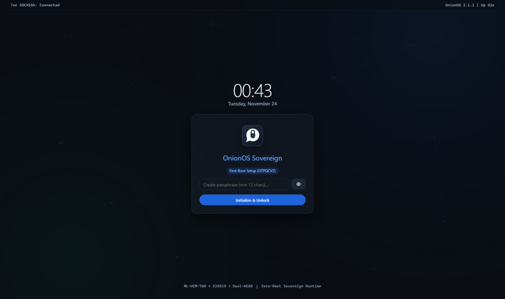
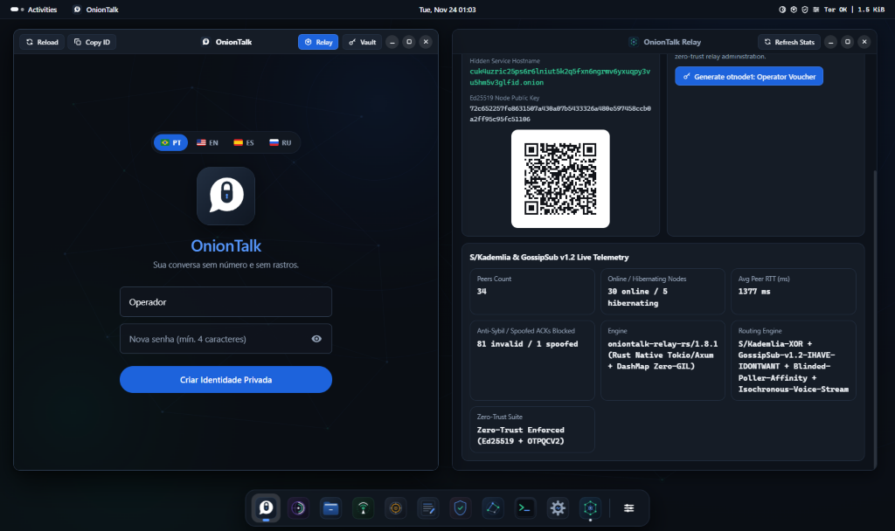
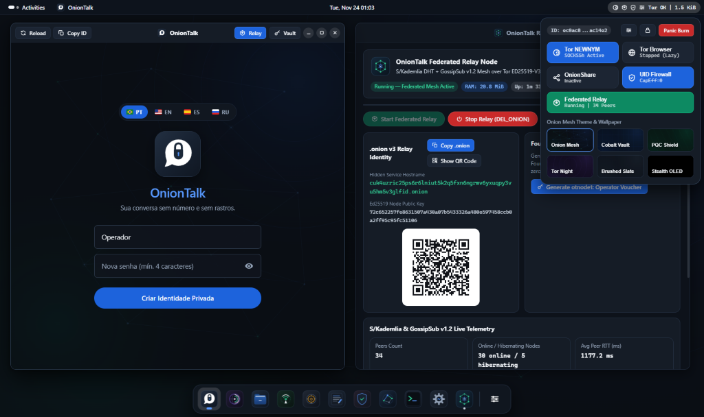
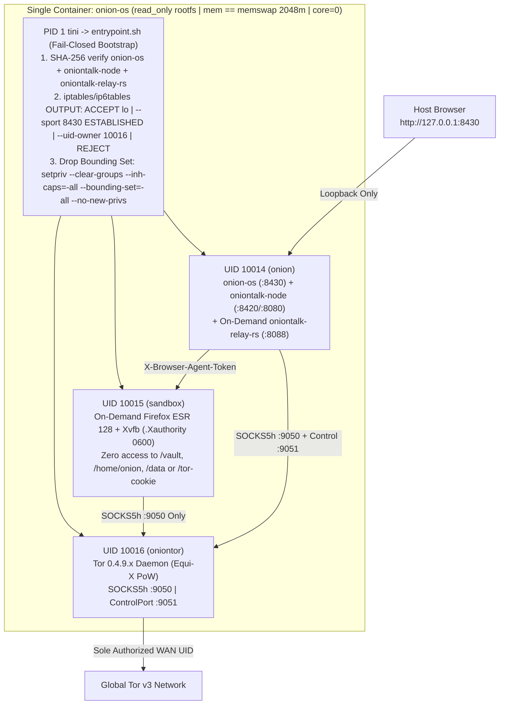

<div align="center">
  
  <h1>OnionOS</h1>
  <p><strong>Sovereign Single-Container Amnesic Tor v3 Workstation, Post-Quantum Desktop &amp; On-Demand Federated Relay (`v1.0.0`)</strong></p>

  <p>
    <a href="https://oniontalk.co/">
      
    </a>
    <a href="https://hub.docker.com/r/eriktonon/onion-os">
      
    </a>
    <a href="https://github.com/onion-talk/onion-os/releases/latest">
      
    </a>
    <a href="https://play.google.com/store/apps/details?id=org.oniontalk.messenger">
      
    </a>
  </p>

  <p>
    <a href="https://github.com/onion-talk/oniontalk-relay/blob/main/docs/PROTOCOL.md">
      
    </a>
    
    
    
    
    <a href="./LICENSE">
      
    </a>
  </p>
</div>

---

## Overview

**OnionOS (`v1.0.0`)** is a consolidated, single-container amnesic Linux workstation built for the **OnionTalk** post-quantum ecosystem, defensive OSINT researchers, journalists, and high-privacy operators. Bound strictly to host loopback (`http://127.0.0.1:8430`), it packages an entire hardened privacy workstation (`< 95 MiB` idle RAM) inside a single `debian:bookworm-slim` OCI container.

The **Onion Mesh** desktop shell runs at `60fps` on the **Obsidian &amp; Cobalt Shield** palette (`#0A0E14` / `#111720` / `#151C26`), combining 6 procedural `<canvas>` wallpapers, 8-edge window resize, 50/50 edge snap, and global search under `default-src 'self'` with zero external CDNs or web fonts. Inside the container, 3 Linux UIDs isolate Tor (`UID 10016 oniontor`), the airgapped browser sandbox (`UID 10015 sandbox`), and the desktop/messenger runtime (`UID 10014 onion`), while boot `iptables`/`ip6tables` rules lock external egress strictly to `--uid-owner 10016` before clearing `CapBnd=0x0` (`NoNewPrivs=1`).

On `/ot/`, OnionOS ships `eriktonon/oniontalk-web:v1.8.1-build74` (`ENVELOPE_V3`, 18-gateway Dual-Ring Rendezvous, 12 MB E2EE attachments, 1x view/listen-once media, `ML-KEM-768` PQC Groups V3, and `OnionVoice`). Operators can also launch or tear down an on-demand S/Kademlia + GossipSub v1.2 Federated Relay (`oniontalk-relay-rs:1.8.1` on `127.0.0.1:8088`) in 1 click using either a disposable RAM `.onion` service or an `OTPQCV2`-persisted identity with instant `otnode1:` voucher issuance.

### Official Docker Hub Images &amp; Immutable Digest (`v1.0.0`)

All 3 tags point to the exact same verified Linux `amd64` container image:

| Docker Hub Repository &amp; Tag | Role | Immutable Digest (`SHA-256`) |
| :--- | :--- | :--- |
| **`eriktonon/onion-os:1.0.0`** | **Pinned immutable release (Recommended)** | `sha256:f11b2042e7791d4e3a2e00df65f4191132d7c493d6fee48bcf4af9b8aaa6fb10` |
| `eriktonon/onion-os:v1.0.0` | Semver `v`-prefixed release alias | `sha256:f11b2042e7791d4e3a2e00df65f4191132d7c493d6fee48bcf4af9b8aaa6fb10` |
| `eriktonon/onion-os:latest` | Rolling stable workstation channel (`1.0.0`) | `sha256:f11b2042e7791d4e3a2e00df65f4191132d7c493d6fee48bcf4af9b8aaa6fb10` |

---

## `Onion Mesh` Desktop Gallery (`v1.0.0`)

| **1. Zero-Root `OTPQCV2` Lock Screen** | **2. Side-by-Side `OnionTalk` &amp; On-Demand Federated Relay** |
| :---: | :---: |
|  |  |
| *Procedural 13-node `Onion Mesh` `<canvas>`, centered `#111720` Obsidian card, Argon2id (19 MiB) + `ML-KEM-768` unlock, and live Tor SOCKS5h status.* | *Simultaneous multi-window desktop running `OnionTalk v1.8.1` (`/ot/`) alongside an active `oniontalk-relay-rs` Hidden Service v3 QR &amp; S/Kademlia telemetry.* |

| **3. System Quick Settings, 6 Live `Onion Mesh` Themes &amp; Panic Burn** |
| :---: |
|  |
| *1-click Tor `NEWNYM` rotation, lazy Tor Browser control, UID Netfilter verification, Federated Relay status, 6 procedural `<canvas>` themes (`Onion Mesh`, `Cobalt Vault`, `PQC Shield`, `Tor Night`, `Brushed Slate`, `Stealth OLED`), and `< 50 ms` `Panic Burn`.* |

---

## 11 Embedded Sovereign Applications

| Application | Capabilities |
| :--- | :--- |
| **1. OnionTalk (`v1.8.1`)** | Full post-quantum P2P messenger (`ENVELOPE_V3`, `otcrl1`, 1x ephemeral media, HD voice notes &amp; `OnionVoice`) |
| **2. OnionTalk Relay (`1.8.1`)** | On-demand Federated Mesh Relay (`ADD_ONION` / `DEL_ONION`, `~9 MiB` active RAM, `otnode1:` voucher generator &amp; live DHT telemetry) |
| **3. Tor Browser (On-Demand)** | Hardened Firefox ESR 128 in isolated `UID 10015` (`Xvfb` + `0600 .Xauthority` + `noVNC`), suspended at `0 MiB` when idle |
| **4. Files (Dual-Root)** | Dual-root file manager switching directly between volatile **Amnesic RAM (`/home/onion`)** and **Encrypted Vault (`/vault/files.otpqcv2`)** |
| **5. OnionShare Dropzone** | Ephemeral `.onion` v3 Hidden Services (`ADD_ONION NEW:ED25519-V3`) for 1-time file sharing &amp; anonymous zero-JS dead-drops |
| **6. Passwords &amp; 2FA** | `OTPQCV2` secret manager with live **RFC 6238 6-digit TOTP** codes &amp; bias-free CSPRNG passphrase/password generator |
| **7. Text Editor** | Markdown/code editor integrated with `ram:/` and `vault:/` plus 1-click `.otseal` PQC export |
| **8. Metadata &amp; PQC Studio** | Binary anti-forensic scrubber (`JPEG`, `PNG`, `PDF`, `WAV`, `MP3`), hybrid `ML-KEM-768` `.otseal` envelopes &amp; offline SVG QR generator |
| **9. Tor &amp; OSINT Lab** | Live Tor `0.4.9.x` `BUILT` circuit hop map (`Guard -> Middle -> Exit`), `NEWNYM` rotation, `.onion` v3 SHA3-256 validator &amp; SOCKS5h recon |
| **10. Console (Multi-Tab PTY)** | Real WebSocket Linux PTY shell (`torsocks`, `qrencode`, `jq`, `onion-pqc`, `onion-clean`, `onion-osint`) |
| **11. System &amp; Settings** | Live `/proc` process &amp; RSS monitor, `CapEff=0`/`CapBnd=0`/`Netfilter` verification, 6 `Onion Mesh` themes &amp; server-side idle auto-lock |

---

## Quick Start (Pre-Compiled Hardened Docker Image)

### Option 1: Single `docker run` Command (`Windows / Linux / macOS`)

```bash
docker run -d \
  --name onion-os \
  --restart unless-stopped \
  --read-only \
  --shm-size 512m \
  --pids-limit 2048 \
  --memory 2048m \
  --memory-swap 2048m \
  --ulimit core=0 \
  --cap-drop ALL \
  --cap-add NET_ADMIN \
  --cap-add SETUID \
  --cap-add SETGID \
  --cap-add SETPCAP \
  --cap-add CHOWN \
  --cap-add DAC_OVERRIDE \
  --cap-add FOWNER \
  --security-opt no-new-privileges:true \
  --tmpfs /tmp:rw,noexec,nosuid,nodev,size=128m,mode=1777 \
  --tmpfs /run:rw,noexec,nosuid,nodev,size=32m \
  --tmpfs /var/lib/tor:rw,noexec,nosuid,nodev,size=64m,uid=10016,gid=10016,mode=0700 \
  --tmpfs /tor-cookie:rw,noexec,nosuid,nodev,size=4m,uid=10016,gid=10016,mode=0750 \
  --tmpfs /data:rw,noexec,nosuid,nodev,size=64m,uid=10014,gid=10014,mode=0700 \
  --tmpfs /sandbox-home:rw,noexec,nosuid,nodev,size=256m,uid=10015,gid=10015,mode=0700 \
  --tmpfs /home/onion:rw,nosuid,nodev,size=256m,uid=10014,gid=10014,mode=0700 \
  -p 127.0.0.1:8430:8430 \
  -v onionos_vault:/vault \
  eriktonon/onion-os:1.0.0@sha256:f11b2042e7791d4e3a2e00df65f4191132d7c493d6fee48bcf4af9b8aaa6fb10
```

Open **`http://127.0.0.1:8430`** in your browser (any custom host loopback port such as `-p 127.0.0.1:8888:8430` is also supported automatically).

### Option 2: `docker compose` (Build or Run from Repository)

```bash
git clone https://github.com/onion-talk/onion-os.git
cd onion-os
docker compose up -d
```

---

## Cryptographic &amp; Kernel Isolation Architecture

Detailed architectural and REST/WebSocket specifications are documented in [docs/ARCHITECTURE.md](./docs/ARCHITECTURE.md) and [SECURITY.md](./SECURITY.md).



| Layer | Implementation |
| :--- | :--- |
| **Post-Quantum Vault (`OTPQCV2\0`)** | `Argon2id (19 MiB, t=2, p=1)` + `SHAKE256` -> `NIST FIPS 203 ML-KEM-768` + `X25519` + Dual-AEAD (`ChaCha20-Poly1305` inner + `AES-256-GCM` outer) + `Ed25519` transcript signature |
| **Anti-Forensic Amnesia &amp; Panic Burn** | `read_only: true` rootfs, `memswap_limit == mem_limit` (zero swap), `PR_SET_DUMPABLE=0`, volatile `tmpfs` workspaces, and `< 50 ms` CSPRNG overwrite + `DEL_ONION` + `SIGNAL NEWNYM` Panic Burn |
| **3-UID Privilege Separation** | `UID 10016` (`tor`), `UID 10015` (`browser-agent`), `UID 10014` (`onion-os` / `oniontalk`), `--clear-groups`, `env -i`, `CapEff=0`, `CapBnd=0`, `NoNewPrivs=1` |
| **Fail-Closed Kernel Firewall** | Boot `iptables`/`ip6tables` `OUTPUT` lock permitting external traffic strictly to `--uid-owner 10016`; container aborts startup if Netfilter cannot lock |
| **Strict Web &amp; Localhost Guards** | `default-src 'self'` CSP (zero external assets), `HttpOnly; SameSite=Strict` session cookie + `X-OnionOS-Token` CSRF header, DNS-rebinding `Host` guard &amp; WebSocket `Origin` guard |

---

## Sponsor &amp; Donate

OnionTalk and OnionOS are free, ad-free, and collect zero telemetry. Community contributions help sustain decentralized relay infrastructure:

| Network | Asset | Official Address |
| :--- | :--- | :--- |
| **Bitcoin** | `BTC` | `bc1q0hr95ay33rtazfepg64yddf52q3yqh7ud83cza` |
| **Ethereum** | `ETH` | `0xE69FCE4Fa35CF3bd98F496337b1eA223270b2c92` |
| **Solana** | `SOL` | `3E8L1Hdqe7Xk6GCrzHbtY5sReAfLFc9CdwgZxP7qaoHq` |

- **Official Website:** [https://oniontalk.co](https://oniontalk.co)
- **Wire Protocol Specification:** [oniontalk-relay/docs/PROTOCOL.md](https://github.com/onion-talk/oniontalk-relay/blob/main/docs/PROTOCOL.md)
- **Instagram:** [https://www.instagram.com/oniontalk.app/](https://www.instagram.com/oniontalk.app/) (`@oniontalk.app`)
- **License:** [MIT License](./LICENSE) (`Copyright (c) 2026 OnionTalk Organization`)
